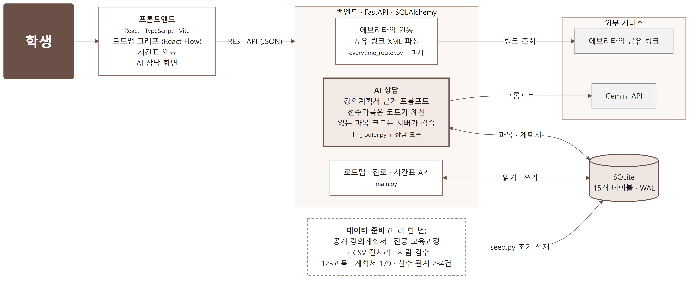
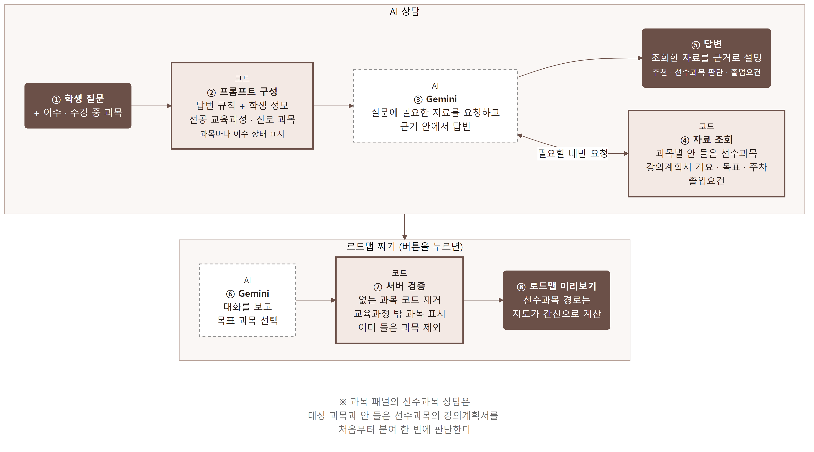
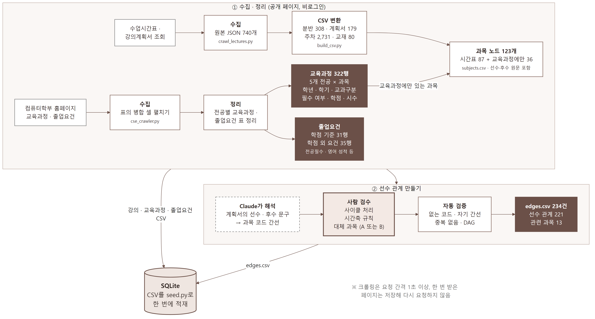

# 경북대학교 컴퓨터학부 전공 로드맵 (KNU CSE Major Roadmap)

컴퓨터학부 전공생을 위한 **진로 기반 수업 추천 및 교육과정 시각화 시스템**입니다.  
전공별 교육과정 그래프를 학기 축으로 배치하고, 진로 프리셋·AI 상담·시간표 연동·이수 현황을 한 화면에서 관리할 수 있습니다.

경북대학교 컴퓨터학부 해커톤 프로젝트입니다.

---

## 주요 기능

| 기능 | 설명 |
|------|------|
| **전공별 로드맵** | 심화컴퓨팅, 인공지능컴퓨팅, 플랫폼SW데이터과학 등 전공별 교육과정을 학기(1-1 ~ 4-2) 열로 시각화 |
| **진로 프리셋** | AI 엔지니어 / 시스템·AI 인프라 / 보안·네트워크 / 웹·앱 서비스 / 데이터 사이언스 경로 강조 |
| **선수과목 그래프** | `pre`(선수), `rel`(관련), `or_with`(대안) 관계를 React Flow로 표시 |
| **AI 상담** | Gemini 기반 일반 상담 및 선수과목 상담, 대화로부터 로드맵 자동 구성 |
| **지어낸 과목 차단** | LLM이 낸 과목 코드를 서버가 실제 과목 목록과 대조해 없는 코드는 버리고, 전공 교육과정 밖 과목은 따로 표시 |
| **이수·성적 관리** | 이수 체크, 성적 입력, 평점 계산, 졸업요건 진행률 표시 |
| **시간표 연동** | 에브리타임 공유 링크 → 학기별 시간표 격자 → 로드맵에 이수/수강 중 반영 |

---

## 구성도

### 시스템 구성



### AI 상담이 답을 만드는 과정



### 데이터 전처리



---

## 프로젝트 구조

```
CSE_Hackathon/
├── README.md                 # 본 문서 (전체 개요)
├── backend/                  # FastAPI 백엔드
│   ├── main.py               # 앱 진입점, 로드맵·이수 API
│   ├── llm_router.py         # AI 상담·로드맵 계획 엔드포인트
│   ├── everytime_router.py   # 에브리타임 시간표 파싱 API
│   ├── models.py             # SQLAlchemy 모델
│   ├── database.py           # DB 연결
│   ├── seed.py               # CSV → DB 시드
│   └── requirements.txt
├── frontend/                 # React + Vite + TypeScript 프론트엔드
│   ├── src/
│   │   ├── App.tsx           # 메인 로드맵 화면
│   │   ├── data.ts           # CSV 파싱 및 전공별 그래프 생성
│   │   ├── careers.ts        # 진로 프리셋 정의
│   │   ├── ChatView.tsx      # AI 상담 탭
│   │   ├── TimetableView.tsx # 시간표 탭
│   │   ├── StatusPanel.tsx   # 평점·졸업요건 패널
│   │   └── ...
│   ├── package.json
│   └── README.md             # 프론트엔드 상세 (화면·파일 설명)
└── data/                     # 데이터 및 LLM 모듈
    ├── curriculum_data/      # 전공별 교육과정 (curriculum.csv)
    ├── graph_data/           # 선수·관련 과목 간선 (edges.csv)
    ├── lecture_data/         # 강의·분반·계획서 CSV
    ├── career_data/          # 진로·진로별 목표 과목
    ├── timetable/            # 에브리타임 파서·픽스처
    └── llm/                  # Gemini 기반 상담·로드맵 모듈
        ├── api.py            # chat / plan_roadmap 함수
        ├── client.py         # Gemini 호출
        ├── context.py        # 데이터 → 프롬프트용 텍스트
        ├── prompts/          # 시스템 프롬프트
        ├── cli.py, demo.py   # 실호출 테스트 (호출마다 API 사용)
        ├── test_api.py       # 오프라인 테스트
        ├── README.md         # LLM 모듈 사용법
        └── BACKEND.md        # 백엔드 연동 명세
```

---

## 빠른 시작

### 1. 백엔드

```bash
cd backend
python -m venv .venv
source .venv/bin/activate          # Windows: .venv\Scripts\activate
pip install -r requirements.txt

# (선택) Gemini API 키 설정
export GOOGLE_API_KEY=your_key     # 또는 GEMINI_API_KEY
# Windows PowerShell: $env:GOOGLE_API_KEY="your_key"
# 또는 data/.env 파일에 GOOGLE_API_KEY=your_key 한 줄 (gitignore 대상)

# DB 시드 후 서버 실행
python seed.py
uvicorn main:app --reload --port 8000
```

- Health check: `http://localhost:8000/health`
- API 문서: `http://localhost:8000/docs`

### 2. 프론트엔드

```bash
cd frontend
npm install
npm run dev                        # http://localhost:5173
```

백엔드 연동 시 `frontend/.env.local`에 다음을 추가합니다.

```
VITE_API_URL=http://localhost:8000
```

`VITE_API_URL`이 비어 있으면 이수 상태·성적은 브라우저 localStorage에만 저장됩니다.

---

## 데이터 개요

| 경로 | 내용 | 건수 |
|------|------|------|
| `data/curriculum_data/curriculum.csv` | 전공 × 과목 교육과정 (권장 학년·학기, 전공필수 여부) | 5개 전공, 322행 |
| `data/graph_data/edges.csv` | 선수(`pre`)·관련(`rel`) 간선 및 대안 과목(`or_with`) | 234건 (`pre` 221, `rel` 13) |
| `data/lecture_data/lecture_data_csv/subjects.csv` | 과목 기본 정보 (학점, 개설 학기 등) | 123과목 |
| `data/lecture_data/lecture_data_csv/sections.csv` 등 | 분반·강의계획서·주차별 내용 | 분반 308, 계획서 179, 주차 2,731 |
| `data/career_data/careers.csv` | 진로 프리셋 정의 | 5개 |
| `data/career_data/career_subjects.csv` | 진로별 목표 과목 | 39행 |
| `data/curriculum_data/out/graduation_credits.csv` | 전공별 졸업 학점 요건 | 31행 |
| `data/curriculum_data/out/graduation_rules.csv` | 전공필수·영어성적 등 학점 외 졸업요건 | 35행 |

데이터는 주로 경북대학교 공개 수업시간표·강의계획서 및 교육과정표를 기반으로 구축되었습니다.

---

## 기술 스택

| 구분 | 기술 |
|------|------|
| Frontend | React 18, TypeScript, Vite, @xyflow/react (React Flow), PapaParse |
| Backend | FastAPI, SQLAlchemy, Uvicorn, Pydantic |
| AI | Google Gemini (`google-genai`), 기본 모델 `gemini-3.5-flash-lite`, 선수과목 상담 `gemini-3.8-flash` |
| Data | CSV (교육과정·간선·강의), SQLite (백엔드 시드 시) |

---

## API 요약 (백엔드)

| Method | Path | 설명 |
|--------|------|------|
| GET | `/health` | 상태 확인 |
| GET | `/api/careers` | 진로 목록과 진로별 목표 과목 |
| GET | `/api/curriculum` | 교육과정 조회 (전공·학년·학기 필터) |
| GET | `/api/roadmap` | 사용자 로드맵·이수·간선 조회 |
| POST | `/api/roadmap/complete` | 이수 토글 |
| POST | `/api/chat` | AI 상담 (general / prereq) |
| POST | `/api/roadmap/plan` | 대화 기반 로드맵 계획 (미리보기) |
| GET / PUT | `/api/roadmap/targets` | 목표 과목 조회·저장 |
| GET | `/api/chat/history` | 사용자별 상담 기록 조회 |
| GET | `/api/everytime` | 에브리타임 공유 링크 → 시간표 |
| GET / PUT | `/api/timetable` | 사용자 학기별 시간표 조회·저장 |
| GET | `/api/subjects/{code}` | 과목 상세 (계획서 등) |

---

## LLM 연동

AI 상담과 대화 기반 로드맵 생성은 `data/llm/` 모듈과 백엔드 `llm_router.py`를 통해 제공됩니다.  
LLM 모듈은 **순수 함수**로만 동작하며, 대화 저장·사용자 데이터 조회·캐싱은 백엔드가 담당합니다.

### 구성 요소

| 구분 | 역할 |
|------|------|
| `data/llm/api.py` | `chat()`, `plan_roadmap()` 공개 함수 |
| `data/llm/client.py` | Gemini 호출, timeout·재시도 처리 |
| `data/llm/context.py` | 교육과정·간선·과목 데이터를 프롬프트용 텍스트로 변환 |
| `data/llm/prompts/` | 시스템 프롬프트 (`general_chat.md`, `prereq_chat.md`, `plan_roadmap.md`) |
| `backend/llm_router.py` | FastAPI 라우터, 요청 검증, DB 연동, 응답 캐싱·로그 |

### 환경 설정

```bash
# 필수: Gemini API 키
export GOOGLE_API_KEY=your_key
# 또는
export GEMINI_API_KEY=your_key

# (선택) 모델 변경. 기본값: gemini-3.5-flash-lite
export GEMINI_MODEL=gemini-3.5-flash-lite
# (선택) 선수과목 상담 모델. 기본값: gemini-3.8-flash (실패 시 GEMINI_MODEL로 전환)
export GEMINI_STRONG_MODEL=gemini-3.8-flash
```

`data/.env`에 키를 두어도 됩니다(gitignore 대상).  
의존성: `google-genai>=3.6.0`, `pydantic>=2` (`backend/requirements.txt`에 포함).

### 주요 함수

| 함수 | 용도 | 반환 |
|------|------|------|
| `chat("general", conversation, completed, major=, targets=)` | 진로·과목·졸업요건 일반 상담. 로드맵 요청을 감지하면 `suggest_action` 반환 | `{reply, suggest_action}` |
| `chat("prereq", conversation, completed, subject=, unmet=)` | 미이수 선수과목을 건너뛸 수 있는지 상담. 대화가 비어 있으면 첫 판단 생성 | `{reply, suggest_action: null}` |
| `plan_roadmap(conversation, major, current_targets, completed)` | 대화를 바탕으로 목표 과목 추가·삭제 계획 생성 | `{add, remove, reasons, outside_curriculum, dropped}` |

- `conversation` 형식: `[{"role": "user"|"assistant", "text": str}]`
- 메시지 상한: 40개(20턴), 메시지당 2,000자
- `completed` / `targets`에는 과목 코드만 사용 (그 외 값은 내부에서 제거)
- 잘못된 입력 → `ValueError` (백엔드에서 400)
- Gemini 실패(한도·503·timeout 등) → `client.LLMError` (백엔드에서 503, 내부 1회 재시도)

### 프론트엔드 연동 흐름

1. **일반 상담** (`ChatView.tsx`)  
   `POST /api/chat` (`mode=general`) → 응답의 `suggest_action === "plan_roadmap"`이면 「이 대화로 로드맵 짜기」 버튼 표시.

2. **로드맵 계획**  
   버튼 클릭 시 `POST /api/roadmap/plan` 호출 → 추가·삭제 미리보기 표시 → 사용자가 「적용」하면 브라우저(localStorage)에 저장. `PUT /api/roadmap/targets`는 백엔드에 있으나 프론트에서 아직 호출하지 않음.

3. **선수과목 상담** (`AdviceBox.tsx`)  
   과목 상세에서 「AI에게 물어보기」 → `POST /api/chat` (`mode=prereq`).  
   처음에는 빈 대화로 호출하여 첫 판단을 받고, 이후 대화를 이어감.

4. 백엔드가 없거나 404/503인 경우 프론트엔드가 localStorage 또는 안내 메시지로 대체 동작합니다.

### 백엔드 처리 요약

- 이수 과목·목표 과목은 DB에서 조회한 뒤 LLM 함수에 전달합니다.
- `prereq` 모드의 `unmet`(미충족 선수과목)은 `course_edges`의 `pre` 간선과 `or_with`를 이용해 백엔드가 계산합니다.
- 동일 요청 재사용과 발표 안정성을 위해 요청·응답을 `llm_logs` 테이블에 저장하는 방식을 지원합니다 (`BACKEND.md` 4절 참고).
- LLM 호출은 동기 함수이므로 FastAPI에서는 `def` 엔드포인트로 두어 이벤트 루프를 막지 않도록 합니다.

더 자세한 함수 계약, 예외 처리, 테이블 제안, 프롬프트 구조는 아래 문서를 참고하십시오.

- `data/llm/README.md` — 모듈 사용법 및 함수 상세
- `data/llm/BACKEND.md` — 백엔드 연동 명세 및 캐싱 전략

---

## 문서 안내

세부 내용은 아래 문서를 참고하십시오.

- **프론트엔드 화면·파일 구조**: `frontend/README.md`
- **LLM 모듈 사용법·함수 계약**: `data/llm/README.md`
- **백엔드–LLM 연동 명세**: `data/llm/BACKEND.md`
- **교육과정 CSV 스키마**: `data/curriculum_data/README.md`
- **선수 그래프 규칙**: `data/graph_data/README.md`
- **강의 데이터 수집·스키마**: `data/lecture_data/lecture_data_csv/README.md`

---

## 개발·기여 시 참고

- 진로 프리셋을 추가·수정할 경우 `frontend/src/careers.ts`를 고친 뒤 `python data/career_data/build_careers.py`로 `data/career_data/` CSV를 다시 만드십시오.
- 선수 관계 변경 시 `data/graph_data/edges.csv`를 수정한 뒤 필요 시 `backend/seed.py`를 다시 실행하십시오.
- LLM 프롬프트는 `data/llm/prompts/`에 위치합니다.
- 발표·데모 시 Gemini 한도·503을 대비해 `data/llm`의 캐시·로그 전략(`BACKEND.md` 4절)을 검토하는 것을 권장합니다.

---

## 출처

본 프로젝트는 경북대학교 컴퓨터학부 해커톤용으로 제작되었습니다.  
강의·교육과정 데이터는 경북대학교 공개 페이지(로그인 불필요)를 기반으로 수집·가공하였습니다.

- 강의·강의계획서: [수업시간표 및 강의계획서 조회](https://knuin.knu.ac.kr/public/stddm/lectPlnInqr.knu)
- 교육과정·졸업요건: [컴퓨터학부 홈페이지](https://aicollege.knu.ac.kr/) 전공별 교육과정 페이지
